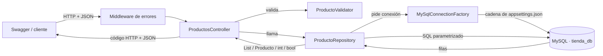

# Productos API — CRUD con ASP.NET Core 10 + MySQL

| | |
|---|---|
| **Universidad** | Universidad Politécnica de Aguascalientes (UPA) |
| **Carrera** | Ingeniería en Sistemas Computacionales |
| **Alumno** | Omar Alejandro Dueñas Cervantes |
| **Matrícula** | UP230254 |
| **Grupo** | ISC09C |
| **Profesor** | Marco Ulises Padilla Galván |
| **Actividad** | Backend CRUD de una entidad (módulo de productos) |

Backend que administra productos con las operaciones **Conexión, Consultas, Insertar, Actualizar, Eliminar y Buscar**, implementando la interfaz `IProductoRepository` y probado con **Swagger**.

- **Lenguaje / framework:** C# · ASP.NET Core 10 Web API (controladores) · Visual Studio 2026
- **Base de datos:** MySQL 8 (también funciona con MariaDB)
- **Acceso a datos:** ADO.NET puro con el driver `MySqlConnector` (sin Entity Framework, el SQL se escribe a mano)
- **Pruebas:** Swagger UI (`Swashbuckle.AspNetCore`)

---

## Estructura del proyecto

```
ProductosApi/
├── Controllers/
│   ├── ProductosController.cs      → endpoints HTTP del CRUD + búsqueda
│   └── ConexionController.cs       → endpoint para probar la conexión a MySQL
├── Data/
│   ├── IDbConnectionFactory.cs     → contrato para pedir conexiones
│   └── MySqlConnectionFactory.cs   → PUNTO 1: crea y abre la conexión
├── Models/
│   ├── Producto.cs                 → entidad (una fila de la tabla productos)
│   └── ProductoRequest.cs          → datos que manda el cliente al crear/editar
├── Repositories/
│   ├── IProductoRepository.cs      → interfaz de la actividad (+ búsqueda)
│   └── ProductoRepository.cs       → PUNTOS 2-6: todo el SQL
├── Validation/
│   └── ProductoValidator.cs        → reglas (campos obligatorios, precio, stock…)
├── Middleware/
│   └── DatabaseExceptionMiddleware.cs → convierte errores en respuestas JSON
├── database/
│   └── script.sql                  → crea la BD, la tabla y datos de ejemplo
├── Program.cs                      → arranque: registra servicios y Swagger
└── appsettings.json                → cadena de conexión
```

---

## Cómo ejecutarlo

1. **Crear la base de datos.** Abrir `database/script.sql` en MySQL Workbench y ejecutarlo completo (o desde consola: `mysql -u root -p < database/script.sql`). Crea la base `tienda_db`, la tabla `productos`, 5 productos de ejemplo y el usuario `productos_api`, que solo tiene permisos de SELECT/INSERT/UPDATE/DELETE sobre `tienda_db` (la API no se conecta como root).
2. **Revisar la conexión.** `appsettings.json` ya apunta a ese usuario:
   ```json
   "ConnectionStrings": {
     "MySql": "Server=localhost;Port=3306;Database=tienda_db;User ID=productos_api;Password=ProductosApi2026;"
   }
   ```
3. **Correr la API.** En Visual Studio elegir el perfil `http` y presionar ▷ (Iniciar sin depurar), o desde la terminal:
   ```bash
   dotnet restore
   dotnet run --launch-profile http
   ```
4. **Abrir Swagger:** <http://localhost:5083/swagger>
5. Primero probar `GET /api/Conexion`; si responde `"conectado": true`, la API ya habla con MySQL.

---

## Endpoints

| Punto | Método | Ruta | Método del repositorio | Respuestas |
|---|---|---|---|---|
| Conexión | GET | `/api/Conexion` | `IDbConnectionFactory.CrearConexion()` | 200 · 503 |
| Consultas | GET | `/api/Productos` | `ObtenerTodos()` | 200 |
| Consultas | GET | `/api/Productos/{id}` | `ObtenerPorId(id)` | 200 · 404 |
| Insert | POST | `/api/Productos` | `Insertar(producto)` | 201 · 400 |
| Actualizar | PUT | `/api/Productos/{id}` | `Actualizar(producto)` | 200 · 400 · 404 |
| Eliminar | DELETE | `/api/Productos/{id}` | `Eliminar(id)` | 204 · 404 |
| Buscar | GET | `/api/Productos/buscar?termino=texto` | `Buscar(termino)` | 200 · 400 |

Ejemplo de cuerpo para **POST** y **PUT**:

```json
{
  "nombre": "Teclado mecánico",
  "descripcion": "Switches rojos y retroiluminación RGB",
  "categoria": "Electrónica",
  "precio": 899.50,
  "stock": 25,
  "activo": true
}
```

---

## Flujo del proyecto



### Explicación general

**Arranque (`Program.cs`).** Cuando la aplicación inicia, `Program.cs` registra las piezas en el contenedor de inyección de dependencias: la fábrica de conexiones (una sola para toda la app porque únicamente guarda la cadena de conexión), el repositorio (uno nuevo por cada petición) y Swagger. Después arma el pipeline: primero el middleware que atrapa errores, luego Swagger y al final los controladores. Gracias a la inyección de dependencias, el controlador nunca hace `new ProductoRepository()`; ASP.NET se lo entrega ya armado en el constructor.

**1. Conexión (`MySqlConnectionFactory`).** Lee la cadena `ConnectionStrings:MySql` de `appsettings.json`. Si no existe, la app se detiene con un mensaje claro en vez de fallar después. Su método `CrearConexion()` crea un `MySqlConnection`, lo abre y lo regresa. Cada método del repositorio la usa dentro de un `using`, así la conexión se cierra sola al terminar (y el driver la reutiliza de su pool, por lo que no es lento).

**Recorrido de una petición.** Cuando en Swagger se ejecuta, por ejemplo, `POST /api/Productos`:
1. Swagger manda el JSON a la API.
2. ASP.NET convierte el JSON a un objeto `ProductoRequest` y llama al método `Insertar` del `ProductosController`.
3. El controlador valida los datos con `ProductoValidator`. Si algo está mal (nombre vacío, precio negativo, stock negativo, textos muy largos) regresa **400** con la lista de errores por campo y **no toca la base de datos**.
4. Si todo es válido, convierte la petición en un `Producto` y llama a `_repositorio.Insertar(producto)`.
5. El repositorio pide una conexión a la fábrica, arma el `INSERT` con parámetros (`@nombre`, `@precio`, …) y lo ejecuta.
6. MySQL guarda la fila y genera el `id`; el repositorio lo lee con `LastInsertedId` y lo regresa.
7. El controlador responde **201 Created** con el producto completo y el encabezado `Location` con su URL.

Todos los demás endpoints siguen el mismo camino: **controlador → validación → repositorio → MySQL → respuesta HTTP**.

### Métodos del repositorio

| Método | Qué hace | SQL | Qué regresa |
|---|---|---|---|
| `ObtenerTodos()` | Lee toda la tabla | `SELECT … ORDER BY id` | `List<Producto>` |
| `ObtenerPorId(id)` | Busca una fila por llave primaria | `SELECT … WHERE id = @id` | el `Producto` o `null` (→ 404) |
| `Insertar(producto)` | Agrega una fila nueva | `INSERT INTO productos …` | el `id` generado |
| `Actualizar(producto)` | Cambia todos los datos de una fila | `UPDATE … WHERE id = @id` | `true` si encontró el id, `false` si no (→ 404) |
| `Eliminar(id)` | Borra la fila | `DELETE … WHERE id = @id` | `true` si borró algo, `false` si no existía (→ 404) |
| `Buscar(termino)` | Busca texto en nombre, descripción o categoría | `SELECT … WHERE nombre LIKE @patron OR …` | `List<Producto>` |

**Helpers internos del repositorio:**
- `LeerProductos(comando)` ejecuta el `SELECT` y recorre el `MySqlDataReader` fila por fila.
- `MapearProducto(lector)` convierte una fila en un objeto `Producto`, leyendo cada columna por su nombre. Si una fila trae datos corruptos, se registra en el log y se salta, sin tirar toda la consulta.
- `AgregarParametrosDeDatos(...)` llena los parámetros que comparten `INSERT` y `UPDATE` para no repetir código.
- `EscaparPatronLike(...)` hace que `%` y `_` se busquen como texto normal y no como comodines.

### Decisiones importantes

- **Consultas parametrizadas.** Nunca se concatena texto del usuario dentro del SQL; se usan parámetros (`@id`, `@nombre`). Eso evita la **inyección SQL**: buscar `' OR 1=1 --` simplemente no encuentra nada.
- **Separación de responsabilidades.** El controlador no conoce SQL y el repositorio no conoce HTTP. Si mañana se cambiara MySQL por SQL Server, solo se reescribiría el repositorio y la fábrica de conexión; el controlador queda igual porque depende de la interfaz `IProductoRepository`.
- **La interfaz se respetó tal cual.** El punto *Buscar* se agregó en una interfaz aparte (`IProductoBusquedaRepository`) que implementa la misma clase, para no modificar la interfaz pedida.
- **Manejo de errores.** Si MySQL está apagado o la contraseña es incorrecta, el middleware responde **503** con un JSON explicativo en lugar de que la API truene.

---

## Pruebas realizadas

| Prueba | Resultado esperado | Resultado |
|---|---|---|
| `GET /api/Conexion` | 200, `conectado: true` (MySQL 8.0.45) | ✅ |
| `GET /api/Productos` | 200, 5 productos de ejemplo | ✅ |
| `GET /api/Productos/2` | 200, Mouse inalámbrico | ✅ |
| `GET /api/Productos/999` | 404 | ✅ |
| `GET /api/Productos/buscar?termino=papel` | 200, 2 productos de Papelería | ✅ |
| `GET /api/Productos/buscar?termino=x` | 400 (término muy corto) | ✅ |
| `POST` con datos válidos | 201, id 6 con fecha asignada | ✅ |
| `POST` con nombre vacío, precio y stock negativos | 400 con error por campo | ✅ |
| `PUT /api/Productos/6` | 200, datos actualizados | ✅ |
| `PUT /api/Productos/999` | 404 | ✅ |
| `DELETE /api/Productos/6` | 204 | ✅ |
| `DELETE /api/Productos/6` otra vez | 404 | ✅ |
| Búsqueda con `' OR 1=1 --` | 200, lista vacía (sin inyección) | ✅ |

Pruebas ejecutadas el 01/11/2026 en Windows con Visual Studio 2026, .NET 10 y MySQL 8.0.45.

_Agregar aquí capturas de pantalla de Swagger como evidencia._
